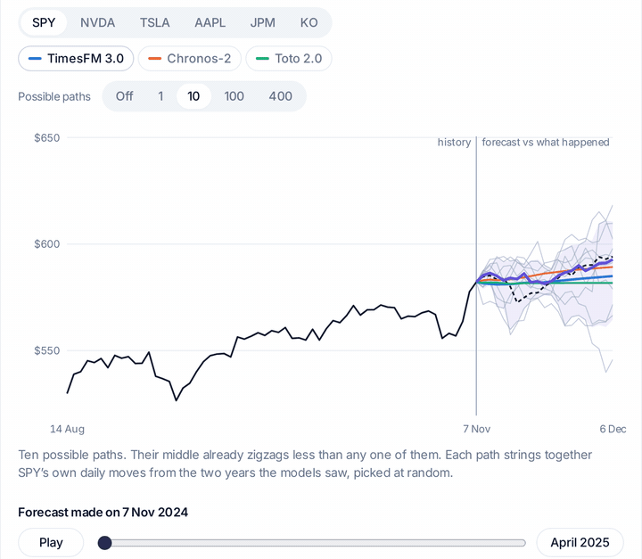
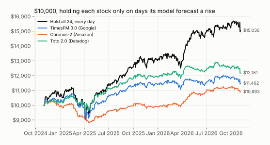

# Can time series foundation models predict stock prices?

The code behind [Can Time Series Foundation Models Predict Stock Prices?](https://moneyheap.ai/blog/can-ai-predict-stock-prices/) on the moneyheap blog: three time series foundation models, zero-shot, on two years of daily prices for 24 large US stocks and ETFs, scored against simple baselines and against random walks.

Models: [TimesFM 3.0](https://huggingface.co/google/timesfm-3.0-pytorch) (Google), [Chronos-2](https://huggingface.co/amazon/chronos-2) (Amazon) and [Toto 2.0 313m](https://huggingface.co/Datadog/Toto-2.0-313m) (Datadog), default settings, no fine-tuning.



Each model's 20-day forecast for SPY on every trading day of the test, next to ten possible paths built from SPY's own past daily moves and what really happened (dashed line). The [interactive version](https://moneyheap.ai/blog/can-ai-predict-stock-prices/) lets you pick a stock and a model.



## What we found

- **Direction:** next-day direction right 49.9% to 51.1% of the time. Always saying "up" got 52.2%. On random walks, which can't be predicted by construction, the models scored the same as on real stocks.
- **Accuracy:** at 1, 5 and 20 days ahead, every model's error was slightly larger than forecasting no change. The correlation between forecast and real moves was -0.02 to -0.01.
- **Backtest:** holding a stock only on days its model forecast a rise, with a 0.05% cost per switch, turned $10,000 into $10,893 to $12,181. Holding all 24 every day turned it into $15,036.
- **Ranges:** the 10%-90% ranges held the real price 72% to 80% of the time. A plain range from the last 60 days of moves covered 79% to 82%.
- **Intraday:** on hourly and 5-minute bars the models were again at coin-flip level; a one-line "the last move reverses" rule did better on 5-minute bars.

The full write-up, with interactive charts and the limits of the test, is [on the blog](https://moneyheap.ai/blog/can-ai-predict-stock-prices/).

## Setup

- 24 tickers: SPY, QQQ, IWM and 21 large US stocks across sectors (`fetch.py`).
- Daily closes from Yahoo Finance, 2 January 2014 to 6 November 2026, adjusted for splits and dividends.
- A forecast from each of the 504 trading days from 1 November 2024, using the previous 512 closes, for 1 to 20 days ahead, with the 10%, 50% and 90% quantiles.
- Control: one simulated random walk per ticker, with the same start price, drift and volatility.
- Intraday: hourly bars (last 730 days) and 5-minute bars (last 60 days), regular trading hours, 512 bars of history, the next 12 bars forecast.

## Run it

```bash
pip install -r requirements.txt
python3 fetch.py            # data/prices.csv
python3 forecast.py         # data/forecasts/<model>.npz, needs a CUDA GPU
python3 analyze.py          # data/results.json and charts/*.svg
python3 intraday.py 1h 5m   # data/intraday-<interval>.csv and data/intraday-results.json
```

Run the scripts from this folder. `forecast.py` takes 10 to 60 seconds per model on an RTX 4090; pass model names (`timesfm-3`, `chronos-2`, `toto-2`) to run only some.

The repository holds the results (`data/results.json`, `data/intraday-results.json`) and the charts, but not the Yahoo Finance prices or the forecasts made from them: `fetch.py` downloads the prices again. Yahoo Finance revises old data now and then, and keeps 5-minute bars for 60 days only, so a new run can differ slightly from ours.

## Limits

This tests the models on price history alone: no news, volume or other covariates, no fine-tuning, one two-year period of a mostly rising market. Some of the models may have seen part of the test period in pretraining, which would flatter them.

This is research, not financial advice or a recommendation to buy or sell any security.

## About

Made by [Adel Zakirov](https://github.com/AdelZakirov) at [moneyheap](https://moneyheap.ai/). MIT license.
